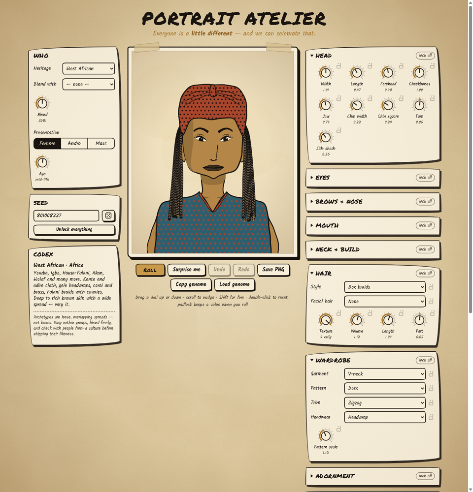

# Portrait Atelier

Procedural, flat-style 2D portraits of people from many heritages, with knobs and dials for every feature.



It follows the "flat painting method" from the reference sheets:

1. **Sketch** with a bold, clean, consistent black outline (hand-inked brush, slight wobble).
2. **Limit the palette** to solid flat colours (no gradients on the figure).
3. **Fill** defined shapes (skin, hair, cloth) with those flats.
4. **Add features** with hard-edged shapes and lines, no blending.
5. **Embellish** with flat patterns and distinct shapes for jewellery.

The faces use the classic head proportions: eyes halfway down, nose halfway between eyes and chin, lip halfway between nose and chin, ears from eye-top to nose-bottom. Every knob then nudges those landmarks, because everyone is a little different.

---

## Running it

There's no build step and nothing to install. **Double-click `index.html`.** It runs from `file://` in any modern browser. Fonts come from Google Fonts; offline it falls back to system handwriting fonts.

| Action | How |
|---|---|
| Turn a dial | Drag up/down (or left/right). **Shift** for fine control. Scroll wheel nudges it. |
| Reset a dial | Double-click it |
| Keep a value when rolling | Click its **padlock**, or use **lock all** on a panel |
| Roll unlocked features | **Roll** button or `R` |
| Random heritage, blend and presentation | **Surprise me** or `S` |
| Undo / redo | `Z` / `Shift+Z` |
| Mixed heritage | **Blend with** another heritage, then turn the **Blend** dial (it morphs live) |
| Export | **Save PNG** (1500×1875). **Copy genome** / **Load genome** gives you a JSON recipe for that exact face. |
| Batch | **Sketchbook**: around the world, same heritage, or blended heritage. Click a thumbnail to open it. |

Changing **Heritage**, **Blend** or **Presentation** re-rolls with the same seed and keeps anything you've locked. That way you can lock a hairstyle, for example, and watch the rest change.

---

## How it works

```
 heritage + blend + presentation + seed
            │  PM.generate()         weighted tables & ranges from js/data/archetypes.js
            ▼
        genome  ──────────────── a flat JSON object: one value per control (+ seed)
            │  PM.geometry()         landmarks: eyes, nose, mouth, ears, head outline, neck, torso
            │  PM.styleColors()      paint style maps true colours → the paint box (C)
            ▼
   layers, in z order (PM.define('layers', …))
   background → hair-back → neck → clothing → necklace → ears → head → skin marks
   → brows → eyes → nose → beard → mouth → face marks → eyewear → hair-front → headwear → earrings
```

Everything draws through a **Painter** (`P`). It wraps the canvas with the ink style: wobbly variable-width brush outlines, flat fills, pattern clipping and offscreen layers. Line weight, wobble and ink colour therefore restyle the whole portrait at once.

Long hair is drawn twice: once behind the head, and once in front of everything with the face cut out. That lets it fall over the shoulders without ever covering the face.

### Project layout

```
index.html               page + script order
css/style.css            parchment, ink & ochre UI
js/core/util.js          seeded RNG, colour maths, curve sampling
js/core/registry.js      PM.define / PM.get / PM.list — the plug-in registry
js/core/painter.js       ink brush, flat fills, patterns, clipping, layers
js/core/geometry.js      head proportions → landmarks
js/core/generator.js     heritage tables → genome
js/core/render.js        the layer stack + PM.render(canvas, genome)
js/core/actor.js         PM.Actor — one animated portrait (blink, talk, expressions), no UI
js/data/controls.js      every knob/dial/select/swatch in the UI (UI builds itself from this)
js/data/archetypes.js    heritage archetypes (skin, hair, eyes, face ranges, wardrobe, palette …)
js/data/styles.js        paint styles + paper backgrounds
js/data/swatches.js      named skin / hair / eye / metal colours
js/parts/features.js     eye shapes, eyes, brows, noses, mouth, ears, beards, signature marks
js/parts/hair.js         hair kit + 24 styles
js/parts/headwear.js     21 headwear pieces
js/parts/clothing.js     19 garments
js/parts/jewelry.js      earrings, necklaces, eyewear
js/parts/patterns.js     textile patterns
js/extensions/example.js a working example of every extension point
js/extensions/speech-synth.js  babble voices (see Voices below)
js/ui/knob.js            the rotary dial widget
js/ui/app.js             panels, locks, undo, sketchbook, export
tools/contact-sheet.html renders every entry of a category, for checking new parts
```

### What's included

- **17 heritages** (+1 example sub-group): West African, East African & Horn, North African, Middle Eastern, South Asian, East Asian, Southeast Asian, Central Asian, Indigenous North American, Mesoamerican & Andean, Latin American, Pacific Islander, Aboriginal & Torres Strait Islander, Northern / Southern / Eastern European, Romani.
- **Hair (25, incl. the example mohawk):** buzz, crop, side part, slicked, high-top, afro, curly, afro puffs, long, shoulder, bob, bangs, buns, ponytail, cornrows, Fulani braids, box braids, locs, twists, plaits, mohawk…
- **Headwear (21):** gele, headwrap, fila, turban, hijab, keffiyeh & agal, kufi, doppa, pakol, kippah, conical hat, fur hat, chullo, beanie, headscarf, tagelmust, coin band, bead band, jasmine, flower crown, crown.
- **Garments (19):** crew, V-neck, turtleneck, suit, wrap/toga, boubou, dashiki, cross-collar, hanbok, deel, mandarin collar, kurta/thobe, embroidered tunic, huipil, poncho, scarf, sari, fur collar, bare shoulders.
- **Patterns (21):** kente, adinkra-style glyphs, mud cloth, batik, ikat, paisley, tartan, keffiyeh fishnet, cross-stitch, Andean bands, blossoms, cloud scrolls, beadwork, and more.
- **Jewellery and details:** 9 earrings, 12 necklaces, 4 eyewear, 7 facial-hair styles, 16 signature marks (freckles, bindi, thanaka, kohl, chin tattoo, nose rings…).
- **4 paint styles:** Ink & Ochre (the poster look), Natural Tones, Ink Wash (navy brush, yellow cheeks), Terracotta. **5 papers.**

---

## Extending it

Every piece is a registry entry: `PM.define(category, id, definition)`. Put your additions in a new file under `js/extensions/`. Add a `<script>` tag for it in `index.html` after `render.js` and before the UI scripts. New entries show up in the dropdowns automatically, and the generator can roll them. **`js/extensions/example.js` contains a working version of every recipe below.**

Open `tools/contact-sheet.html?cat=hair` (or `headwear`, `clothing`, `patterns`, `marks`, …) to see every entry of a category at once.

### Shared vocabulary

Every draw function receives the same four things:

| arg | what |
|---|---|
| `P` | Painter: `P.shape(pts, fill, opts)`, `P.line(pts, opts)`, `P.band(centerLine, width, fill, opts)`, `P.circle`, `P.ellipse`, `P.dot`, `P.bead`, `P.hair` (thin texture stroke), `P.clip(dense, fn)`, `P.ring(outer, inner, fill)`, `P.layer(fn)` + `Q.erase(dense)` |
| `g` | genome: `g.faceWidth`, `g.hairVolume`, `g.pattern`, `g.age`, `g.gender`, … (see `controls.js`) |
| `geo` | landmarks: `cx, cy, hw, hh, top, chinY, fx, eyeY, noseY, mouthY, browY, hairlineY, eyes[], ears[], ew, eh, mw, nw, neckX, neckBase, sw, headDense, widthAt(y), torso(neckline)` |
| `C` | paint box: `ink, paper, skin, skinShade, skinDeep, hair, hairHi, iris, lip, blush, cloth[0..2], metal, white` |

Points are `[x, y]`, or `[x, y, true]` for a **sharp corner**; everything else is smoothed. Shapes are flat-filled and inked automatically. Common shape options are `{ w: 0.6 }` (relative line weight), `{ stroke: false }`, `{ wob: 0 }` (no wobble), `{ smooth: false }`, and `{ pattern: { id, colors, scale } }`. Canvas space is 500×625.

### Add a heritage (or a sub-group)

```js
PM.define('archetypes', 'ainu', {
  label: 'Ainu', region: 'East Asia',
  notes: 'Indigenous people of Hokkaido… (shown in the Codex panel)',
  skin: [['I-2', 2], ['II-1', 3], ['II-2', 2]],          // keys from swatches.js, or '#hex'
  hairColor: [['black', 5], ['darkBrown', 3]],
  eyeColor: [['brown', 4], ['darkBrown', 3]],
  hairTexture: { 1: 2, 2: 4, 3: 3 },                    // 1 straight … 4 coily
  eyeShape: { 'deep-set': 3, almond: 2, round: 1 },
  face: { browThick: [1.1, 1.7] },                      // any knob id → [min, max]
  hair: { fem: { long: 3, 'bun-low': 1 }, masc: { shoulder: 2, 'short-crop': 1 } },
  facialHair: { masc: { 'full-beard': 4, 'long-beard': 2 } },
  clothing: { 'embroidered-tunic': 3, wrap: 1 },
  patterns: { 'cross-stitch': 2, zigzag: 2 },
  marks: { blush: 0.2 },                                // independent probabilities
  palette: ['#2b3a67', '#f1e6cc', '#16120f', '#a8302a'],
});
```

Any field you leave out falls back to `PM.ARCHETYPE_DEFAULTS`. Gender-split tables use `{ fem: {…}, masc: {…} }`; "Andro" blends the two. To make a **sub-group**, copy a parent and override some fields: `Object.assign({}, PM.get('archetypes', 'west-african'), { label: 'Yoruba', headwear: {…} })`.

Keep ranges **wide and overlapping**. Give each heritage one or two signature details, not a caricature.

### Add a hairstyle

Use the hair kit and you get a silhouette, face cut-out, texture from the Texture knob and hat handling for free:

```js
PM.hairKit.hairStyle('pixie', {
  label: 'Pixie cut',
  silhouette: (geo, g) => PM.hairKit.capSil(geo, g, { vol: 6 }),   // or longSil / cloudSil / your own points
  hole: geo => ({ bangs: geo.browY - 14 }),                        // fringe; or { cover, square, noPart, line }
  texture: 'flow',                                                 // 'auto' | 'flow' | 'coil' | 'none' | fn
  // strands: () => ({ kind: 'braid' | 'loc' | 'twist', count, width, len }),
  // backExtra(P, g, geo, C) {…}   e.g. a bun behind the head
  // frontExtra(P, g, geo, C) {…}  e.g. plaits over the shoulder: PM.hairKit.plait(P, C, pts, width)
  hatFallback: 'short-crop',                                       // used under hats that squash hair
});
```

You can also skip the kit and write `PM.define('hair', id, { back(P,g,geo,C){…}, front(P,g,geo,C){…} })` yourself.

### Add headwear

```js
PM.define('headwear', 'bandana', {
  hides: { hair: 'top' },              // 'all' skips hair (hijab); 'top' squashes volume; also ears/earrings: true
  front(P, g, geo, C) {
    const { cx, hw, top, hairlineY } = geo;
    P.shape([[cx - hw * 1.05, hairlineY + 6], [cx, top - 10], [cx + hw * 1.05, hairlineY + 6], [cx, hairlineY + 12]],
            C.cloth[1], { pattern: { id: 'dots', colors: [C.cloth[1], C.white, C.ink], scale: 0.8 } });
  },
  // back(P,g,geo,C) draws behind the head; late(P,g,geo,C) draws over jewellery (veils)
});
```

### Add a garment

```js
PM.define('clothing', 'tank-top', {
  draw(P, g, geo, C) {
    const neckline = PM.necklines.round(geo, 30, 1.6);     // or .v(geo, depth, width) / .straight(geo, y) / your own points
    P.shape(geo.torso(neckline), C.cloth[0], { pattern: { id: g.pattern, colors: C.cloth, scale: g.patternScale } });
  },
});
```

### Add a pattern

```js
PM.define('patterns', 'pinstripe', {
  draw(P, box, colors, rng, scale) {            // already clipped to the shape
    P.ctx.fillStyle = colors[0]; P.ctx.fillRect(box.x, box.y, box.w, box.h);
    for (let x = box.x; x < box.x + box.w; x += 8 * scale) P.hair([[x, box.y], [x, box.y + box.h]], 1, colors[1], { smooth: false });
  },
});
```

### Earrings, necklaces, eyewear, beards, marks, noses, eye shapes

These all use the same pattern: `PM.define('earrings' | 'necklaces' | 'eyewear', id, { draw(P, g, geo, C) {…} })`.

- **Facial hair** uses `{ under(P,g,geo,C), over(P,g,geo,C) }`. `under` is drawn before the mouth, `over` after it.
- **Marks** use `{ layer: 'skin' | 'top', draw(P,g,geo,C) }`. They show up as chips.
- **Noses** use `{ draw(P,g,geo,C) }`.
- **Eye shapes** are pure parameters: `PM.define('eyeShapes', 'wide', { up: 1.1, lo: 0.7, peak: 0.5, tilt: 0, drop: 0, crease: 'line' | 'hood' | 'deep' | 'none', fold: 0..1 })`.

### Add a knob (or dropdown, swatch, chips)

```js
PM.controls.push({ id: 'shade', type: 'knob', group: 'Head', label: 'Side shade',
                   min: 0, max: 1, step: 0.01, def: 0, roll: [0, 0.45], sex: { masc: 0.1 } });
```

The UI builds it into that group's panel, with a padlock. The generator rolls it inside `roll`, using archetype `face` ranges when they exist. Your part reads it as `g.shade`. Other types:

- `{ type: 'select', source: '<registry category>' }`
- `{ type: 'color' }`
- `{ type: 'chips', source }` for multi-select
- `{ type: 'segment', options: [[value, label], …] }`

A new `group` name creates a new panel.

### Add a layer

```js
PM.define('layers', 'flat-shade', { z: 56, draw(P, g, geo, C, ctx) { /* ctx = { hair, headwear } defs */ } });
```

Layers draw in `z` order (see `render.js` for the built-in numbers). A layer that throws is skipped and logged, so one broken part never blanks the portrait.

### Add a paint style or paper

```js
PM.define('styles', 'risograph', {
  label: 'Risograph', ink: '#1b2a6b', paper: '#f5efe2',
  palette: ['#1b2a6b', '#ff5a7a', '#f5efe2', '#ffd23f'],   // clothing snaps to these
  skin: g => PM.color.mix('#ff9a8a', g.skin, g.toneMix),
  hair: () => '#1b2a6b',
});
PM.define('backgrounds', 'grid', { draw(P, g, geo, C, rng) { /* fill the 500×625 canvas */ } });
```

### Add a whole new category

`PM.define('tattoos', 'swallow', {...})` creates the category. Add a control `{ id: 'tattoo', type: 'select', source: 'tattoos' }` and a layer that draws `PM.get('tattoos', g.tattoo)`. To roll it per heritage, add `tattoo: 'tattoos'` to `PM.ROLL_SOURCES` and a `tattoos: {…}` table to your archetypes.

---

## The genome

A portrait is just JSON, so it's easy to save, share, diff, or feed to a game:

```json
{ "seed": 801008227, "archetype": "west-african", "mixWith": "", "mix": 0.5, "gender": "fem", "age": 0.31,
  "faceWidth": 1.01, "jaw": 0.79, "eyeShape": "almond", "noseStyle": "broad", "hairStyle": "box-braids",
  "hairTexture": 4, "headwear": "headwrap", "clothing": "vneck", "pattern": "dots", "skin": "#5a3826",
  "style": "ink-ochre", "lineWeight": 1, "wobble": 1, "...": "..." }
```

In code, call `PM.generate({ seed, archetype, mixWith, mix, gender, base, locked })` to get a genome. Then call `PM.render(canvas, genome)` to draw it at the canvas's size, at any resolution. Missing fields are filled with defaults, so old genomes keep working when you add controls.

---

## Voices

`js/extensions/speech-synth.js` gives every portrait a voice that babbles like the characters in *Reigns* or *Animal Crossing*. Actors talk out loud automatically, and their mouths move in time with the syllables.

- **Heritage sets the language.** Each heritage has its own invented tongue: which consonants and vowels it uses, its syllable shapes, stress or tones, speed and melody. Every English word maps to the same made-up word in it, so "no, no, NO!" repeats, and people from one culture share a vocabulary. A blended heritage switches between its two languages word by word.
- **Presentation and age set the register.** Children are small and high, elders a little shaky.
- **Six Voice genes make each person sound like themselves:** Pitch, Timbre, Breath, Gravel, Pace and Melody. They have their own card in the Atelier (**Hear voice** plays a sample, and letting go of a dial plays one too). You can lock them like any other knob, and `PM.breed` passes them down to children.
- **Expression sets the mood.** Angry speech is tense and loud, sad speech slow and low, scared speech quick and trembling.
- **Punctuation shapes the melody.** Questions rise, statements fall, CAPS are stressed and "…" trails off. "Hmm", "ha!", "oh", "uh" and "ugh" sound the same for everyone.

There are three engines. Choose with the **Voices** picker in the Animator or on the Voice card:

| Engine | What it is |
|---|---|
| **Babble synth** (default) | The prosody engine: a harmonic glottal source with a natural spectral roll-off, formants gliding per sample and a brightness that follows each segment, so words link and breathe. Heritage colour (register, timbre and accent strength) is layered on top, so different backgrounds sound distinct. It works offline, every voice is distinct, and lines are deterministic. |
| **Classic synth** | The original formant synthesiser, kept so you can switch back to exactly how it sounded before. |
| **Device voices** | Your browser's or system's speech voices, reading the same invented words. They are chosen by heritage and presentation, with pitch and speed set by the genes. They often sound more natural, but the selection varies by device and only one voice can speak at a time. |

```js
PM.voice.say(genome, 'Have you eaten yet?', { expr: 'happy' });  // → { duration, stop() } or null
PM.voice.babble(genome, 'Have you eaten yet?');                   // → "kpa lo leka ku?"
PM.voice.render(genome, text);                                    // → { pcm: Float32Array, sampleRate, duration, mouth }
PM.voice.render(genome, text, { engine: 'classic' });             // render with the original engine
PM.voice.mode = 'off';                                            // 'synth' | 'classic' | 'device' | 'off' (remembered)
```

Browsers only allow sound after the first click or key press, so lines spoken before that are silent.

## Using it in a game (Phaser or any canvas engine)

Load the scripts with plain `<script>` tags, in the same order as `index.html`, and **leave out `js/ui/*`**. They attach to `window.PM`. Put your own `PM.define(...)` additions in your game's code after `render.js`. Don't edit this repo.

Use **`PM.Actor`** (`js/core/actor.js`) for an animated portrait. It blinks, talks, eases between expressions, looks around, nods and shakes:

```js
const actor = new PM.Actor(character.genome, { width: 250 });  // actor.cv is a canvas (4:5)
actor.setExpr('angry');           // any id from js/parts/expressions.js
actor.say('You dare?');           // mouth flaps (and babbles out loud with speech-synth.js); actor.line holds the text
actor.act('nod');                 // 'look left' | 'look right' | 'look center' | 'look away' | 'nod' | 'shake' | 'blink'
// every frame:
actor.update(dt);                 // dt in seconds
actor.draw();                     // redraws actor.cv (only the face is re-rendered; the rest is cached)
// when it leaves the screen:
actor.destroy();
```

Phaser: `const tex = scene.textures.addCanvas('p_' + id, actor.cv); scene.add.image(x, y, tex);`, then in `update()` call `actor.update(delta / 1000); actor.draw(); tex.refresh();`. Offset the sprite's y by `actor.bob()` for nods.

Keep only a few live actors on screen (for example the people in a dialogue). For lists of many characters, render a still with `PM.render(canvas, genome)` at a small size, or bake a couple of frames (neutral and blink) from an actor into a spritesheet. Store characters as **genomes** (JSON), not images. `PM.generate({ seed, archetype, gender })` makes new ones.

---

## Guardrails (from the reference guide)

- **Vary within groups more than between them.** Ranges are deliberately wide, and every heritage includes several eye shapes, noses and textures.
- **No single look per group.** Use Blend for diaspora, mixed heritage and future/fusion characters; it's a first-class feature.
- **Fashion isn't costume.** Most heritages mix everyday, formal and traditional garments.
- **Sacred items are left out.** That includes war bonnets, moko and tatau. Ceremonial dots and cheek lines are generic, decorative stand-ins. Research protocols before adding culturally specific sacred items.
- **Consult people from a culture** before shipping their likeness in a product, and credit inspirations (the Codex panel is a start).
